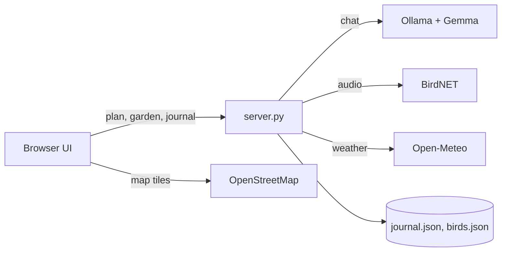

# Touch Grass Planner

> A local-first outdoor companion. An open-weight model on your own machine plans the outing, then the screen goes dark and you go outside.

Built for the **Hacktoberfest 2026 Open-Source AI Challenge, Week 1** (theme: *Touch Grass*).

<!-- Add screenshots here after you run it:


-->

## What it does

| Feature | What you get | Needs internet? |
|---|---|---|
| **Outing plan** | A short, specific plan written by Gemma (via Ollama) from your activity, time, conditions, garden jobs and route | No |
| **Loop route** | A triangle loop sized to your time, computed on-device from compass bearings, drawn as a sketch and on a map, with a Google Maps walking link | Map and link only |
| **What to notice** | A 5-item checklist tied to your activity. Ticks are counted in your journal | No |
| **Start timer** | Press *Start* and the screen turns into a dark countdown that shows your loop map and legs. *I'm back* logs the outing | No (map tiles need it) |
| **Garden planner** | What to sow this week. Tropical mode (Sri Lanka, Maha/Yala seasons) or frost mode (from your frost dates) | No |
| **Live weather** | Temperature, sky, wind and sunset, filled into the conditions box | Yes (Open-Meteo) |
| **Bird ID** | Record 15 seconds or upload audio. BirdNET names the species and keeps a life list | No after setup |
| **Journal and streak** | Days-outside streak and the last five outings, stored in a local file | No |
| **Print** | A print view of the plan so you can close the laptop | No |

## Why open matters here

- **Works with no signal.** The plan, garden list, timer, journal, notice list and loop sketch all run on your machine.
- **Your data stays with you.** Journal, bird life list and frost dates live in local files and browser storage, not on a server you do not control.
- **Swap the model with one setting.** `TG_MODEL=llama3.1:8b` or any model Ollama can run. Nothing else changes.
- **Zero running cost.** No API keys, no per-call fees.
- **Editable data.** The crop calendars are plain Python lists (`FROST`, `TROPICAL` in `server.py`). Change them for your region.
- **Honest fallback.** If the model is not running, the app says so and uses a plain template. It never pretends.

## How it works



`server.py` is a standard-library Python HTTP server (no pip packages needed). `index.html` is a single file with inline CSS and JavaScript.

## Open-source stack

| Piece | Used for |
|---|---|
| [Gemma 3](https://ai.google.dev/gemma) (open weights) | Writing the outing plan |
| [Ollama](https://ollama.com) | Running the model locally |
| [BirdNET-Analyzer](https://github.com/birdnet-team/BirdNET-Analyzer) | Bird sound identification (optional) |
| [Open-Meteo](https://open-meteo.com) | Free weather, no key |
| [Leaflet](https://leafletjs.com) and [OpenStreetMap](https://www.openstreetmap.org) | The loop map |

## Quick start

You need Python 3.9+ and Ollama.

1. **Install Python** from python.org. On Windows, tick *Add python.exe to PATH*.
2. **Install Ollama** from ollama.com/download.
3. **Download the model** (about 3 GB, once):
   ```
   ollama pull gemma3:4b
   ```
   On a weak laptop use `gemma3:1b` and set `TG_MODEL=gemma3:1b`.
4. **Run the app** from the project folder:
   ```
   python server.py        # Windows (or: py server.py)
   python3 server.py       # macOS / Linux
   ```
5. Open **http://localhost:8000**. The top-right text should say *Local model gemma3:4b ready*.

Microphone and location only work on `localhost` or HTTPS.

### If `ollama pull` fails (network problems)

Download the GGUF yourself and import it:

1. Download `gemma-3-4b-it-Q4_K_M.gguf` from the `unsloth/gemma-3-4b-it-GGUF` repository on Hugging Face (resumable: `curl.exe -L -C - -o gemma-3-4b-it-Q4_K_M.gguf <url>`).
2. In the same folder create a file named `Modelfile` (no extension):
   ```
   FROM ./gemma-3-4b-it-Q4_K_M.gguf
   TEMPLATE """{{- range $i, $_ := .Messages }}
   {{- $last := eq (len (slice $.Messages $i)) 1 }}
   {{- if or (eq .Role "user") (eq .Role "system") }}<start_of_turn>user
   {{ .Content }}<end_of_turn>
   {{ if $last }}<start_of_turn>model
   {{ end }}
   {{- else if eq .Role "assistant" }}<start_of_turn>model
   {{ .Content }}{{ if not $last }}<end_of_turn>
   {{ end }}
   {{- end }}
   {{- end }}"""
   PARAMETER stop "<end_of_turn>"
   PARAMETER top_k 64
   PARAMETER top_p 0.95
   ```
3. Run `ollama create gemma3:4b -f Modelfile`, then `ollama list` to confirm.

## Using the app

1. Pick an activity and how many minutes you have.
2. Press **Use my location** to fill live weather, or type conditions by hand (for example `cloudy, light rain later, muddy trail, with my dog`). More detail gives a more specific plan.
3. Press **Make my plan**. You get the plan, a notice checklist, and (outdoor activities) a loop with a map.
4. On a laptop the location can be kilometres off. **Click the map** where you really are to set the start point. Press *Use my location* to go back to live location.
5. Press **Start. Screen goes dark.** and go. Press **I'm back. Log it.** when you return.
6. Tick the notice items on the way. The count is saved with the outing.

Garden panel: choose *Tropical (Sri Lanka)* or *Has frost* under **Your climate**. Frost mode needs your last spring frost and first fall frost dates.

## Configuration

| Variable | Default | Meaning |
|---|---|---|
| `TG_MODEL` | `gemma3:4b` | Ollama model name |
| `OLLAMA_URL` | `http://localhost:11434` | Where Ollama is running |
| `PORT` | `8000` | Server port |
| `HOST` | `127.0.0.1` | Bind address (`0.0.0.0` in Docker) |
| `DATA_DIR` | project folder | Where `journal.json` and `birds.json` are written |

PowerShell: `$env:TG_MODEL="gemma3:1b"; python server.py`. macOS / Linux: `TG_MODEL=gemma3:1b python3 server.py`.

## Bird ID setup (optional)

BirdNET pulls in TensorFlow, which may not support the newest Python. Use Python 3.12 in a virtual environment:

```
py -3.12 -m venv .venv
.venv\Scripts\activate
pip install birdnet-analyzer
python server.py
```

macOS / Linux: `python3.12 -m venv .venv`, `source .venv/bin/activate`. The first analysis may download model files, so run it once with internet. Check the BirdNET license terms before any commercial use.

## HTTP API

| Method | Path | Purpose |
|---|---|---|
| GET | `/` | The app |
| GET | `/api/status` | Is Ollama up and is the model installed |
| GET | `/api/garden?climate=tropical` or `?climate=frost&last=YYYY-MM-DD&first=YYYY-MM-DD` | Crops to sow now and soon |
| GET | `/api/weather?lat=..&lon=..` | Weather text from Open-Meteo |
| GET / POST | `/api/journal` | Read or add an outing |
| POST | `/api/plan` | JSON in, plan text out |
| POST | `/api/birds?lat=..&lon=..` | Raw WAV in, top 5 species out |

## Data and privacy

- `journal.json` and `birds.json` are created next to `server.py` (or in `DATA_DIR`). They are in `.gitignore`.
- Browser `localStorage` keeps your climate, frost dates, saved coordinates and the pinned-start flag.
- Network calls go only to: Open-Meteo (weather), OpenStreetMap and the Leaflet CDN (map), and Google Maps only if you click the walking link. Plans and audio never leave your machine.

## Deploy

**Docker**
```
docker build -t touch-grass-planner .
docker run -p 8000:8000 -e OLLAMA_URL=http://<ollama-host>:11434 touch-grass-planner
```
Add `--build-arg WITH_BIRDS=1` to include BirdNET (large image, needs more memory).

**Render.** Push to GitHub, then *New > Blueprint* and pick the repo. `render.yaml` is included. Set `OLLAMA_URL` to a remote Ollama. The free tier cannot run the model, so without `OLLAMA_URL` the hosted app uses the template plan and says so on screen.

**DigitalOcean.** Run Ollama on a Droplet (GPU image for speed), start it with `OLLAMA_HOST=0.0.0.0 ollama serve`, and firewall port 11434 to your app only.

Hosted copies share one journal stored in `/tmp`, which is wiped on restart. Treat them as demos. The private, offline experience is the local one.

## Project structure

```
touch-grass-planner/
├── server.py      # stdlib HTTP server, garden logic, Ollama, weather, BirdNET calls
├── index.html     # whole UI: HTML, CSS, JS
├── Dockerfile     # optional BirdNET via WITH_BIRDS=1
├── render.yaml    # Render blueprint
├── README.md
└── .gitignore
```

## Troubleshooting

| Problem | Fix |
|---|---|
| Status says *Model offline* | Start the Ollama app (Linux: `ollama serve`) |
| Status says *Run: ollama pull ...* | The model is not installed. Pull or import it, then refresh |
| `python` not recognised | Reinstall Python with PATH ticked, or use `py server.py` |
| Plan says *offline template* | Ollama is not running or the model name does not match `TG_MODEL` |
| Weird text such as `<end_of_turn>` | Use the Modelfile template above when importing the GGUF |
| Location blocked | Click the site icon in the address bar, set Location to Allow |
| Map is not drawn | Needs internet. The sketch shows instead |
| Location is far off | Laptops guess from Wi-Fi or IP. Click the map to set your start |
| *BirdNET not installed* | See Bird ID setup |
| *BirdNET failed ... ConnectionError* | First run needs internet to fetch model files. Try another network |

## Known limitations

- The loop is a straight-line triangle, not turn-by-turn. It can cross water or private land. Use the maps link for real streets and trails.
- The tropical crop list is a general guide for hill-country and intermediate-zone Sri Lanka. Confirm with your local Department of Agriculture office.
- Small models can be wrong or repetitive. Treat plans as suggestions and check conditions yourself.
- Bird ID depends on recording quality and BirdNET's coverage. Treat low-confidence results with caution.
- Hosted demos do not run the model unless you connect a remote Ollama.

## Roadmap

- Toggle to hide the map on the dark screen
- Fine-tuned local model for regional garden advice
- Offline map tiles
- Sinhala and Tamil plan text

## Contributing

Issues and pull requests are welcome. Good first changes: add crops for your region, new activities, or translations. Keep the app dependency-free on the Python side.

## Acknowledgements

Gemma (Google), Ollama, BirdNET (Cornell Lab of Ornithology and Chemnitz University of Technology), Open-Meteo, OpenStreetMap contributors, Leaflet.

## License

Add a `LICENSE` file (MIT is a common choice for challenge entries). Gemma and BirdNET have their own terms; follow them if you redistribute models.
